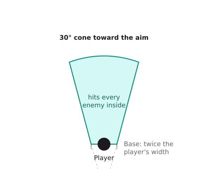
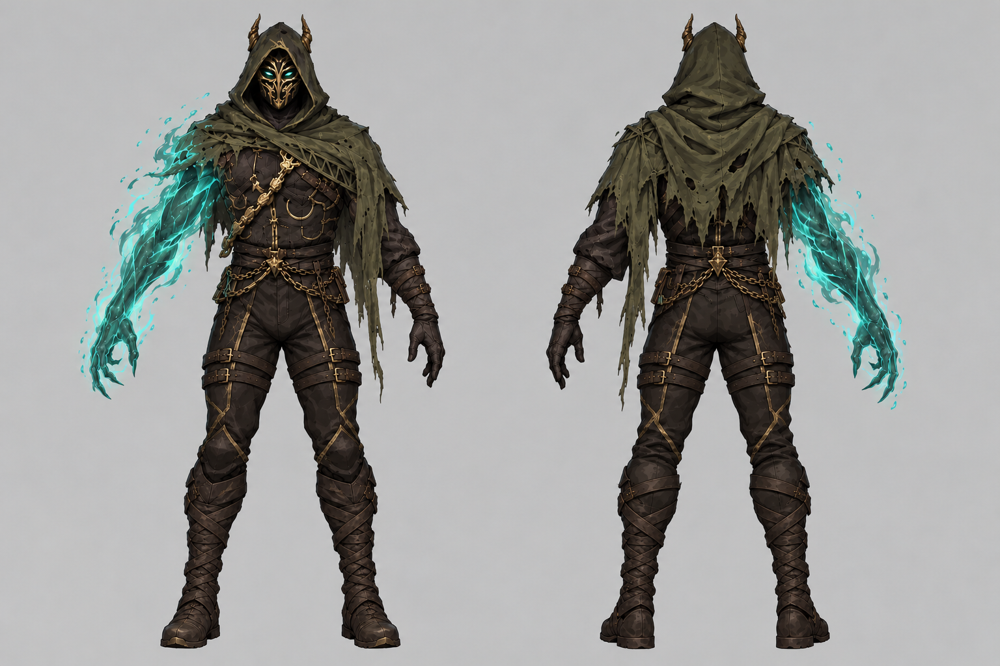

# Dark Touch — Game Design Document (full reference)

This is the complete version of the GDD: every decision made so far, in detail, in one place. It is meant for readers who have time, or who are looking for one precise rule.

**Three versions of the GDD exist:**

| Version | For whom | Length |
| --- | --- | --- |
| [GDD](GDD.md) | A human reader who wants the whole game quickly | 6 pages |
| GDD full reference (this document) | A human reader who wants every rule, or searches for one | As long as needed |
| [Canon](canon.md) | The AI agents: validated facts only, one per line, read first on every task | Short |

When a decision changes, all three are updated together. Points not yet decided are marked **To define** and listed in [Open questions](open-questions.md).

**Contents**

1. Overview
2. Story and world
3. Combat
4. Resources
5. Abilities
6. Necromancy: Raise and Reap
7. The army
8. Soldier types
9. Names, grades and ranks
10. Elites and capture
11. Run structure
12. Progression and gear
13. Controls and camera
14. Art direction
15. Audio and music
16. User interface
17. AI architecture
18. Technical strategy
19. Production plan and costs

## 1. Overview

**Dark Touch is a roguelike where a spectral dark-magic arm raises fallen enemies into your army, played with WoW-style GCD and rotation combat using aimed abilities.**

A mage who lost an arm made a pact with a dark entity. The cursed arm it gave him casts on its own and turns every kill into a potential soldier. Every corpse is a choice: raise it to grow the army, or reap it to fuel your spells. Hidden stat grades and ranks turn army building into a hunt for the perfect soldier.

| | |
| --- | --- |
| Genre | Roguelike with army building and aimed, rotation-based combat |
| Engine | Unreal Engine 5. Gameplay logic in Blueprints; C++ only where optimisation requires it |
| Camera | Directly behind and above the player, WoW-style, with zoom in and out |
| Platform | PC, mouse and keyboard. A controller may come later, so no system should make it impossible |
| World | Cel'ardor (working name), a continent at war |
| Art style | Stylised, in the spirit of Fellowship |
| Music | Dark neoclassical, cello-led, adaptive to the situation |
| Demo scope | One level of 5 sections ending with a boss; 7 spells at the start, 5 more unlocked by player level |
| Production | Built over 7 weeks for the ELVTR "Multi-Agent AI for Game Development" course, by one game designer and a team of 10 AI agents. The scope is knowingly ambitious: Dark Touch is the game I have always wanted to make, and I am ready to keep finishing and polishing it for a month or more after the course if needed |

### Inspirations

| Source | What Dark Touch takes from it |
| --- | --- |
| Solo Leveling | Raising defeated enemies as soldiers; the rank names Shadow, Asset, Ace, General |
| World of Warcraft | Ability bar, global cooldown, cast times, no casting while moving, camera, Soul Shards |
| Fellowship | Ability-bar combat and art style |
| Diablo 4 | Unlockable variants that change how an ability works |
| Mythic+ (WoW) | Difficulty tiers that make mobs stronger and rewards better |
| Pokémon | Capturing special creatures and keeping them in a collection |

### Pillars

- **Every corpse is a decision.** Raise or Reap, and which soldiers are worth keeping.
- **Skill-based casting.** Abilities are aimed by the player; casting is a commitment, because you cannot move while casting.
- **The hunt for the perfect soldier.** Random names, hidden grades and visible ranks make each soldier unique.
- **The arm is the star.** The cursed arm is the visual and audio signature of the game.

## 2. Story and world

**Cel'ardor** (working name) is a continent entirely at war. In Cel'ardor, mages need both arms to cast spells.

The player is a mage who lost an arm. Believing he would never cast a spell again, he accepted a pact with a dark entity he knows little about. It gave him a magic arm that casts spells on its own, granting him the powers of a necromancer.

He wakes up in a small town. To protect the village, he raids the enemy army before it can attack. He knows he must relearn magic entirely with this new power, so he is glad to start by protecting a small village, and later bring destruction to his enemies once he has mastered it.

**To define:** the entity, the war and its factions.

## 3. Combat

Combat plays like a WoW ability bar, but **every ability is aimed by the player**.

### Casting

- Abilities are either **instant** or have a **cast time**.
- A **global cooldown (GCD) of 1 second** follows **every spell except Reap**.
- **No casting while moving**, except **Splinters, Grasp, Frenzy, Hunger and Rot**, which can be cast on the move.
- **Taking a hit does not interrupt a cast: it pushes the cast back by 1.5 seconds.** The cast bar shows this pushback.
- **Only stuns interrupt a cast.** Stuns come from the Mage's long charged spell and the Blademaster's parry; other sources may be added.

### Defence

- **There is no dodge.** Enemy attacks with a windup, like the Blademaster's parry, are answered by stopping the cast and moving away.

### Damage

- **Damage and HP loss are always whole numbers.** Every result is **always rounded down**.

### Rotation

- Fillers build Souls; spenders consume them.
- **Base rotation, without talismans** (single target; in AoE, Death Nova replaces Unholy Impale):

| Priority | Ability | When |
| --- | --- | --- |
| 1 | Unholy Impale / Death Nova (spenders) | When Souls are capped: always spend, never overcap |
| 2 | Splinters with a proc | When Souls are not capped: a proc beats the spender |
| 3 | Unholy Impale / Death Nova (spenders) | Whenever Souls allow it |
| 4 | Rot | On the main enemy, if it is not cursed |
| 5 | Splinters | Whenever a charge is ready; helps generate Souls |
| 6 | Deathbolt | Cast-time filler, when nothing else is ready |

- **Splinters proc:** every hit the player deals, **except Splinters' own hits**, has a **10% chance** to grant a free Splinters charge and **double the damage** of the next Splinters. **Up to 2 procs** can be held: at most, both charges are empowered (charges never go above 2, and a charge is never more than doubled). A proc empowers the charge it gives; if both charges are already there, it empowers an existing one instead. With 2 procs already active, a third proc is lost.
- **Rot and the proc:** Rot's first hit on a target has the normal **10%** chance; each later tick has only **1%**, so multi-target Rot cannot make AoE far stronger than single target.
- **Soldiers' hits never trigger the proc** (a passive may allow it later).
- **Free spender proc:** Splinters' hits can instead make the next spender (Unholy Impale or Death Nova) **free**: it costs no Souls when cast. **5% chance per enemy hit**; only **one** free spender can be stored. AoE taking over the rotation most of the time is intended.
- **Power of Below** is the personal offensive cooldown that empowers the rotation (section 5).

## 4. Resources

| Resource | Role | Gained by | Spent on |
| --- | --- | --- | --- |
| Spirit | Army resource (the name replaces "mana"); **max 100 + 20 per player level** | **50** on entering each section; **5** per Reap; some variant passives | Raise (**20–180**, by rank and grades); revive (**60% of the soldier's raise cost**) |
| Souls | Short-loop resource, like WoW Soul Shards; **max 6** | Deathbolt (1), Splinters (1, or 2 with a proc); kills and Reap give none; some talents change how they are gained | Spenders: **3 each** |
| HP | The player's health | Hunger; **Reap for HP** (2 s cast, 20% of max HP) | Damage taken; **no regeneration over time** |

- **There is no currency:** no gold, no shop.
- **Souls cap at 6**, so two spenders' worth. Each spender (Unholy Impale, Death Nova) costs **3 Souls**. **Deathbolt** gives **1 Soul**; Splinters gives **1 Soul**, or **2 with a proc**; Rot gives none. Souls above 6 are lost, which is why the rotation always spends at the cap.
- **Maximum Spirit is 100 at level 1 and grows by 20 per player level** (380 at level 15). It lets the player save Spirit between sections for expensive high-rank raises, and gives real power growth per level.
- **All Spirit numbers are tuned on the [Rank Odds board](https://claude.ai/artifact/DfuKmSVMsquH5RjLVcJHt3)** (Spirit economy section), the source of truth for the data tables.
- **Spirit does not regenerate over time.** Entering a section gives **50 Spirit** (up to the cap); a **Reap** gives **5**; some variant passives give more.
- **No spell costs Spirit except Raise and revives.** A revive costs **60% of that soldier's raise cost**, rounded down: 30 for a Shadow with A grades, 12 for a Shadow with three B grades, 108 for a General with three S grades. Spirit is the resource of the army: every raise and every revive competes for it.
- **This is an exchange rate, by design.** A section holds about **5 fights**, and higher tiers bring more enemies, so more corpses.
- **Raise cost depends on the corpse:** a base cost by rank (**Shadow 50, Asset 75, Ace 110, General 150**), **+10 per S grade** and **−10 per B grade** across its three stats. A Shadow with three B grades costs 20; a General with three S grades costs 180.
- **Why:** at tier 1 the average cost is about 40, so about **2–3 raises per section** with room for a revive or a Reap for HP. At tier 20, Generals cost 150+, so the player raises about 2–3 Generals per section and the full General army arrives near the end of the run. Costs grow with tiers as corpses multiply, and every corpse's grades matter before raising. Cheap B-grade soldiers are natural fodder for Hunger.
- **HP does not regenerate over time either.** The player heals with **Hunger** (instant, costs a soldier) or by **reaping a corpse for HP** (slow, free).

## 5. Abilities

Names are **final**, except **Deathbolt** and **Death Nova**, which will be renamed.

| Ability | Role | Aiming | Details |
| --- | --- | --- | --- |
| Deathbolt | Single-target filler | Aimed | **1.75 s** cast; gives **1 Soul**; last in the rotation priority |
| Unholy Impale | Single-target spender | Aimed | **2 s** cast; consumes 3 Souls |
| Splinters | AoE filler, instant | 30° cone from a narrow base | **2 charges**, each recharging in **5 s**; weak damage; builds Souls. Proc: 10% on any player hit (1% on later Rot ticks) grants a free charge and doubles its next hit; up to 2 procs, so at most both charges are empowered |
| Death Nova | AoE spender | Ground circle | **2 s** cast; consumes 3 Souls |
| Grasp | Root | Ground circle | Holds enemies in place |
| Swap | Mobility | Aimed | Swap places with one of your soldiers |
| Frenzy | Army buff | All soldiers | Timed buff on every soldier |
| Hunger | Self-heal | Aimed | Replaces Death Trap. **Instant**, castable while moving, **10 s cooldown**; targets **only the player's own soldiers**: hitting one of your summons grabs it and consumes its HP; the player regains HP equal to the summon's remaining HP, **capped by the soldier's rank: at most 30% of the player's max HP for a Shadow, 40% for an Asset, 50% for an Ace, 60% for a General**. The eaten soldier **becomes a corpse again** and can be **revived for 60% of its raise cost**: eat, revive, eat again is an intended loop that turns Spirit into healing. **Chosen cannot be eaten** |
| Rot | Damage over time | Aimed, hitscan | Replaces Flying Filthy Dagger. **Instant**; generates **no Souls**. No projectile: if aimed at a target, curses it with a debuff dealing damage **every 1 s for 10 s**. Rot can be on **several enemies at once**. Recasting it on a target already cursed **refreshes the duration to 10 s** (no stacking). Castable while moving |
| Power of Below | Offensive cooldown | Self | Haste buff inspired by the WoW Frost Mage's Icy Veins: **GCD 0.75 s**, **cast times halved** (Deathbolt 0.875 s), **Splinters charges recharge in 3 s** instead of 5 s, and the **spenders become instant**, so they can be cast while moving |
| Raise | Necromancy | Aimed | Turns a corpse into a soldier (section 6) |
| Reap | Necromancy | Aimed | Consumes a corpse for a 10 s buff, plus either 5 Spirit (instant) or 20% of max HP (2 s cast); no Souls (section 6) |

### Variants

- Each ability has **two unlockable variants**, Diablo 4-style, that change how it works. Reap has **three**: HP regeneration, damage, or speed.
- What each variant does, and at which level it unlocks: to define.

### Aiming

- Aimed abilities fire where the player points. Whether they get a soft-targeting assist or stay raw aim is decided during prototyping.
- Ground-circle abilities are placed on the ground.
- **Splinters is a cone:** it hits every enemy inside a **30° cone** toward the aim. The cone does not start from a point: it starts from a **flat base about twice the player's width**, so enemies right next to him are hit too, and its far edge is rounded. It is the kit's AoE filler.

### Availability

- **7 spells at the start:** Deathbolt, Unholy Impale, Splinters, Death Nova, Raise, Reap, Hunger (one of the two heals, with Reap for HP).
- **5 spells unlocked by player level:** Grasp, Swap, Frenzy, Rot, Power of Below.
- **Variants are equipped in variant slots**, also unlocked by player level (6 slots by level 15): each slot holds one variant, and **a spell can have only one variant equipped**. See section 12.

## 6. Necromancy: Raise and Reap

**Every corpse is a choice: Raise it into a soldier, or Reap it for power.** Both are performed with the dark-magic arm.

### Raise

- **Costs Spirit by rank and grades:** Shadow 50, Asset 75, Ace 110, General 150; +10 per S grade, −10 per B grade (section 4).
- **Any rank the player meets can be raised**; the difficulty tier decides which ranks appear (section 9).
- Has a **cast time**, and the player must be **close to the corpse**, so raising mid-fight is a skill check: it costs time and positioning.
- Each raised soldier takes one army slot.
- Raising is the signature moment of the game: it has its own iconic cello motif and the strongest visual effect on the arm.

### Reap

- **Reap for Spirit is instant; Reap for HP is a 2 s cast** (below).
- Grants a **10-second buff** for the player and the army. **No Souls.**
- **Two kinds of Reap, chosen with the mouse after pressing the Reap key:** **left click = Reap for Spirit** (instant, 5 Spirit); **right click = Reap for HP** (**2 s cast** like a Raise, the player stands close and still, pushback applies, heals **20% of max HP**). Choosing with two separate clicks means cancelling a heal can never turn it into a Spirit Reap by mistake.
- **A corpse left by Hunger can be reaped too**, including for HP: one last heal from the same soldier before it is gone for good.
- **With no Reap variant equipped**, the buff heals **every army soldier by 1% of its HP per second for 10 s**. A Reap variant replaces it with HP regeneration, damage or speed.

**The trade-off:** raising grows the army but costs time, exposure and Spirit; reaping for Spirit is instant and pays for future raises and revives, while reaping for HP keeps the player alive.

## 7. The army

### Slots

- Each soldier takes a slot. **All 10 army slots are open from the start.**
- **3 of the slots are golden:** a soldier placed in a golden slot gives the player its type's ability as a castable spell (section 8).
- **Dismissing** a soldier frees its slot.

### Behaviour and orders

- With no orders, soldiers **attack the first enemy they see**.
- Soldiers are dragged into **3 command groups** in the army tab.
- **Each group has a hotkey that selects it.** Selecting a group swaps the action bar to the **order bar**, where the player has placed **Attack**, **Protect** and **Move**, like a WoW Rogue's action bar changing in stealth. **Giving an order swaps back to the spells instantly**; pressing the group key again swaps back without giving an order.
- **Three orders:** **Attack**; **Protect** (attack the biggest threat to the player); **Move** (place soldiers, for example to position ranged ones).

### The collection and the run's army

- **Winning a run adds every soldier you raised and won with to your collection**, at the base.
- **A run starts with up to 3 Chosen**: soldiers brought from the collection, depending on player level. None at level 1, then 1, 2 and 3 as Chosen slots unlock (section 12). **The rest of the army is raised on the battlefield**, every run.

| Soldier | Rule | On a win | On a death |
| --- | --- | --- | --- |
| Chosen | 0 to 3 soldiers brought from the collection, by player level | Stay in the collection | Stay in the collection |
| Raised soldiers | Up to the 10-slot cap | Join the collection | Lost |
| Captured elites | Sent to the collection (section 10) | Join the collection | **Lost** |

### Fallen soldiers

- **Any fallen soldier can be revived for 60% of its raise cost**, so stronger soldiers cost more to bring back.
- A raised soldier that falls and is **not revived before the player leaves the current section is lost** for the run. A Chosen that falls stays in the collection.
- Before moving on, the player must decide which fallen soldiers are worth the Spirit.
- Whether reviving is possible during combat or only once the section is clear: to define.
- **When a run ends, every soldier in the collection is ready again**, so the player can start a new run immediately.

## 8. Soldier types

**Enemies and soldiers share the same roster and the same behaviour:** a creature you fought plays the same way once raised.

| Type | Description | Behaviour | Targeting | Ability given to the player |
| --- | --- | --- | --- | --- |
| Guard | Sword-and-shield footman | Sometimes raises its shield: stands still and turns slowly | None | **Guard:** damage reduction for 1.5 s |
| Mage | Ranged caster | Arcane bolts; occasionally a long charged spell for massive damage that **stuns** | Its biggest threat | To define |
| Rogue | Dual blades; fast, high damage, squishier than Guards | 1 s windup, then dashes through normal mobs | The player and elites first | To define |
| Tank | Armoured, slow, hits hard, very tough | Holds the line | None | **Taunt:** all nearby enemies focus the Tank, Rogues included |
| Blademaster | Two-handed elite class: sturdy, hard-hitting, fairly fast | Occasionally parries, with a visible windup, sending damage back and **stunning** | None | **Parry:** sends an attack back at 2x damage |
| Berserker | Frenzied melee fighter | **Leaps** onto its target; **Whirlwind**, a quick, simple AoE around itself, like the WoW Warrior's Whirlwind (not the long channelled version) | To define | To define |

- **A type's ability is available only from a soldier placed in one of the 3 golden army slots.** Each golden slot gives one castable ability, so at most 3 at a time.

## 9. Names, grades and ranks

**Hunting for the right soldier is a core part of the game.**

### Names

- Every mob gets a **random name** (the player can rename soldiers at the base) from a list of **200 European first names** ([data/mob-names.csv](data/mob-names.csv)), from French, German, Italian, Spanish, Portuguese, English, Nordic, Slavic, Celtic, Dutch, Greek, Hungarian, Baltic and Latin traditions.

### Grades (hidden)

- While alive, all mobs of a type share the same base stats.
- Each mob rolls a hidden **grade for each stat**:

| Stat | What it affects |
| --- | --- |
| Vitality | Max HP |
| Attack | Damage |
| Speed | Cast speed for ranged types, movement speed for melee types |

| Grade | Multiplier |
| --- | --- |
| S | 1.25x |
| A | 1x |
| B | 0.75x |

- **Aiming at a corpse** opens a **world widget** above it showing its name, rank and the grade of each stat. An elite's widget has the same **gold outline** as its health bar.
- **Holding Alt** shows every health bar and every corpse widget at once, to read the whole battlefield quickly.
- Higher difficulty tiers give **better odds** of high grades (see Difficulty tiers and ranks).

### Ranks (visible)

- Inspired by Solo Leveling. Rank boosts **every** stat without changing the grades.
- **A better rank almost always means a better soldier: this is intended.** Grades decide between soldiers of the same rank.
- **Ranks appear with difficulty:** Ace from tier 8, General from tier 14 (see below).
- Each rank has a **colour**. On enemies it shows on the **health bar** (styled like the default modern WoW retail nameplate), not on the body. On corpses it is a **faint aura**, weaker than on summons but visible. On summons it is a strong **aura** that dominates their palette.

| Rank | Rank number | Multiplier | Colour |
| --- | --- | --- | --- |
| Shadow | 1 | 1x | Pale green |
| Asset | 2 | 1.5x | Purple |
| Ace | 3 | 2x | Black, thin silver edge |
| General | 4 | 2.5x | Red with a black outline |

### Formula

**Effective stat = (Base × Grade) × (1 + (Rank number − 1) × 0.5)**

Example: a General (rank 4) with an S in Attack deals Base × 1.25 × 2.5 = 3.125 times the base damage, rounded down to a whole number.

### Difficulty tiers and ranks

- **Tiers are endless**, like Mythic+ keys. Beating a tier unlocks the next. **Tier 20 is the top end game**: a full General army, S-grade elites and a well-thought-out build.
- **Up to tier 20, enemies get stronger through their number and their ranks.**
- **Above tier 20, the odds and the number of enemies stay as at tier 20**, and each tier adds **+20% damage and HP** to every enemy (tier 21: +20%, tier 22: +40%, and so on).
- **This boost is for enemies only:** a raised or captured soldier does not keep it.
- **Each tier sets how many enemies a fight has**, a random number in a range: **2–3 at tier 1, 12–15 at tier 20**.
- **Each tier decides which ranks can appear:** Asset from tier 3, Ace from tier 8, **General from tier 14**, rising to about 20% of normal mobs at tier 20.
- **The exact numbers live on the [Rank Odds board](https://claude.ai/artifact/DfuKmSVMsquH5RjLVcJHt3)**: enemies per fight, rank odds and grade odds for every tier. It is the source of truth the agents turn into a UE5 data table.
- **Every rank the player meets can be raised.** Difficulty decides what the player meets, so he never sees a soldier he is not allowed to raise.
- **"Level" only means the player's level (1–15).** A rank has a rank number (1–4), used in the formula.
- **A Chosen above the tier's highest rank fights at that rank** (for example, a General brought into tier 5 fights as an Asset), so a strong collection cannot trivialise easy tiers.
- **Grades keep the grind alive:** the chance of an S grade rises with the tier (about 5% at tier 1 to 25% at tier 20, tuned on the Rank Odds board). An all-S General is a long-term goal.

## 10. Elites and capture

- **Any mob can be an elite:** a richer version of the enemy palette, a **gold outline on its health bar**, and a stat boost over the normal version.
- **A raised elite is captured**, Pokémon-style. It does not join the run's army: it is sent to the **army at the base**.
- **Every elite that falls can be captured.** There is no limit per run. Whether the base army has a size limit: to define.
- A captured elite **keeps its elite status and its stats**.
- **A captured elite is lost if the player loses the run**, so dying on purpose cannot farm elites.
- **For now, a capture works like a normal raise.** A special capture is planned for later, possibly a rhythm mini-game where the player aligns their aura with the elite's.

**The base** is the menu between runs. It holds the **collection** of soldiers, and the player chooses:

- which Chosen to bring (up to 3, by player level),
- which talismans to equip,
- the difficulty tier.

In the base, a **Rename** button lets the player give any soldier a new name, if they wish; otherwise it keeps its random name.

## 11. Run structure

| Element | Decision |
| --- | --- |
| Demo | One level ending with a boss |
| Full game (later) | 3 medium levels, each ending with an elite or a boss; 20–25 minutes per run |
| Layout | Outdoors for now: **5 sections per run**, cleared one after another; each section holds about **5 fights** |
| Sections | Leaving a section is a decision point: fallen raised soldiers not revived are lost. **The player cannot go back** to a previous section |
| Win | Kill the final boss |
| Lose | The player's HP reaches 0 |
| Difficulty | Endless Mythic+-style tiers (tier 20 = top end game): stronger mobs, more enemies and higher ranks (General from tier 14), better grade odds, more experience |

- To define: the enemy roster of the level, the boss and its mechanics (idea: the boss summons adds during the fight, switching the rotation between single target and AoE to break the rhythm), the size of sections, what marks a section's exit, hidden chest placement, the run length of the demo, and how the number of enemies grows from tier 1 to 20.

## 12. Progression and gear

| What | Rule | On a win | On a death |
| --- | --- | --- | --- |
| Collection | Soldiers raised and won with, plus captured elites | Grows | Unchanged (this run's raises and captures are lost) |
| Chosen | 0 to 3 per run, by player level | Kept | Kept |
| Talismans | The only gear | To define | To define |
| Spells and slots | Unlocked by player level | Kept | Kept |
| Talents | Passive; some change how Souls are gained | Kept | Kept |

### Talismans

- The **only gear**: no armour.
- Found in **hidden chests** or **dropped by foes**.
- **2 equipped** before a run, at the base. Each boosts the stats of **one specific spell**.
- **Target: 2–3 new talismans unlocked per completed run**, so they stay rare but every finished run brings something new. The drop rate is set once the number of enemies per fight is known.
- To define: which stats they boost, rarity, how many can be owned, whether those found are kept after a death.

### Player level

- **Experience is earned in runs and kept even when the run is lost; levels are gained at the end of a run.** **Maximum level: 15.** Level 1 is the start.
- **Levels 2 to 15 give 14 unlocks:** the **5 spells** (Grasp, Swap, Frenzy, Rot, Power of Below), **6 variant slots**, and **3 Chosen slots** (bring 1, 2, then 3 Chosen from the collection; the first one at level 2).
- The order is set on the [Level Unlocks board](https://claude.ai/artifact/NqX8sL4fDcjPXyauHew4vz), where the designer drags the unlocks between levels.
- **After every run** the player grows the collection and gains new unlocks, talismans and slots; **in every run** the rest of the army is raised from the battlefield.
- To define: the experience curve, and the talent list.

## 13. Controls and camera

- **Camera:** directly behind and above the player, WoW-style, with zoom in and out.
- **Keys:** fully rebindable. Defaults: **A, E, R, F, 1–5**, and **Shift +** the same keys: **18 slots**. At level 15 they hold exactly the **12 spells**, the **3 golden-slot abilities** and the **3 command-group keys**. Selecting a group swaps the bar to the orders (Attack, Protect, Move). Their default assignment: to define.
- **Mouse:** aims every ability.
- **Controller:** may come later; nothing should block it.
- **Accessibility** (for example, reducing camera shake): to define.

## 14. Art direction

Full details in [Art direction](art-direction.md).

- **Style:** stylised, in the spirit of Fellowship.
- **Pipeline:** concept images with GPT image generation → 3D characters with **Meshy AI** → rigged to the UE5 Mannequin skeleton.
- **One skeleton for everyone:** every character uses the **UE5 Mannequin ("Manny") skeleton**, so all animations are shared.
- **The player is two skeletal meshes** on that skeleton: the body without the right arm, and the cursed arm alone. The arm gets its own material and effects without touching the body.

### The dark-magic arm

- The player fights with no blade. The right arm is **not physical**: translucent, glowing dark magic, swirling spectral energy that drifts off as wisps and particles, with long clawed fingers.
- It still acts like a real arm: it can **strike, grab and hold things**. That is how it casts, raises and reaps.
- It **must stand out in every animation**: casting, raising, reaping and idle.
- Its colour: **cyan-turquoise**, matching the eyes, so it never reads as the pale-green Shadow aura.

**The main character:** hood with small golden horns, ornate golden mask with glowing cyan eyes, tattered olive-green mantle, dark leather armour with gold trims and chains, no long coat (only fitted trousers, straps and wrapped boots below the belt, so the legs need no cloth animation), athletic build close to Manny's proportions. Only the mantle may need light physics.

**Readability palettes:** enemies are warm and alive (burnt orange `#C8641E`, ivory `#E8DCC0`, warm steel `#9A9590`, tan leather `#8A5A34`, warm skin `#C99A7A`); summons are cold and spectral (slate `#5E6670`, ashen blue-grey `#3E4650`, corpse pale `#A9B0B0`, emissive cyan `#3FE0D0` like the arm). One material per type: a "Raised" parameter switches palettes. Elites: the enemy palette, richer and darker.

**Rank colours:** on enemies, shown on the health bar only (elites add a gold outline); on corpses, a faint aura; on summons, an aura (material overlay plus a little smoke) that dominates the palette (section 9).

## 15. Audio and music

Full details in [Audio and music](audio-and-music.md).

### Music

- **Dark neoclassical. The cello always leads the melody.** Mood reference: Requiem for Wonderland by Nox Cantabile.
- **Phonk elements** (slowed drums, deep bass) to test under the cello; the cello stays the lead. How much and in which layers: to define.
- **Adaptive layers:** exploration, combat, boss.
- **The raise motif:** raising a soldier plays an iconic cello motif.
- Created with AI music tools by the Music Director agent; references are mood boards only.

### Sound effects

- Free, **commercial-safe** sources only: CC0, Pixabay licence, or CC-BY with credits.
- Every ability and hit has a distinct sound, so the fight can be read by ear.
- Reviewed on the [Dark Touch Sound Board](https://claude.ai/artifact/RfTmdaNEp5cF3bLusSwN8b): 3 candidates per sound; pick one or ask for 3 more.

## 16. User interface

The UI makes the rules visible. Screens, in the current draft order of importance:

| Screen | What it must show |
| --- | --- |
| In-game HUD | Ability bar, cast bar with the 1.5 s pushback, Spirit and Souls, command groups, enemy health bars in their rank colour, WoW retail style, gold outline for elites |
| Army tab | Soldiers with names, grades and ranks; drag and drop into the 3 command groups |
| Builds tab | Abilities, variant slots, talents |
| Level-up | End-of-run level-up and the unlock gained |
| Pre-run (the base) | Soldiers to bring, talismans, difficulty; a Rename button on each soldier |
| End of run | Result, soldiers kept or lost, captured elites |
| Main menu | Start, settings, quit |
| Pause and settings | Key bindings, accessibility |

- Designed by the UI Designer agent, one screen at a time, 4 mockups per screen. Final order and the agent's model: to define.

## 17. AI architecture

**Each agent shapes a part of what the player sees, hears and fights; none of them ships anything without the designer's approval.**

| Agent | Its effect on gameplay |
| --- | --- |
| Gameplay Programmer | Every rule in this document becomes a working system: aimed casting with the 1.5 s pushback, Raise and Reap, army slots and command groups, grades and ranks, talismans and progression. |
| AI Director | Every enemy and soldier fights with its own readable personality: Rogues dash at the player, Tanks pull aggro with Taunt, Blademasters telegraph their parry. One behaviour per type serves both sides. |
| Game Feel Director | Every ability, hit, raise and button press has its own feel through hit-stop, camera shake, sound and UI feedback; fillers stay light, spenders hit hard, raising is the signature moment. |
| Animation Scraper | Every action and ability has a validated animation on the shared Manny skeleton, so characters move consistently and the arm stays readable. |
| Environment Scraper | The level is built from coherent, stylised assets that frame each arena and keep characters readable from the camera. |
| UI Designer | The HUD and menus make the rules visible: pushback on the cast bar, grades and ranks in the army panel, command groups a drag away. |
| Music Director | The cello-led score shifts between exploration, combat and boss layers, and every raise triggers the same motif. |
| Sound Designer | Every ability and hit gets a distinct sound effect. |
| Technical Director | A full army of 10 soldiers plus enemies keeps a stable frame rate, and systems never conflict. |
| Game Director | Everything stays consistent with the GDD and with itself: one art style, one audio identity, one set of rules. |

### Review flow

1. A builder agent finishes a task.
2. The **Technical Director** checks that it works and fits the other systems.
3. The **Game Director** checks that it fits the game and the canon. Verdict: approved, approved with notes, or changes required.
4. **The designer validates.** Validated facts go into [canon.md](canon.md), which every agent reads first.

## 18. Technical strategy

### Agent roles in detail

Each agent's full prompt is in the [agents](agents/) folder.

**Gameplay Programmer** — Claude Opus 5.5 — [prompt](agents/gameplay-programmer.md)

- Builds the game's systems: abilities and casting, resources, raising and reaping, army and command groups, grades and ranks, run structure, progression.
- For each system: **explains** how it will build it (Blueprint classes, components, interfaces, data tables, inputs and outputs, risks, test plan) and **waits for validation**; then **builds**, the designer **tests**, and it **iterates** until validated.
- Every tunable number in a data table; systems talk through interfaces and event dispatchers. Never invents a mechanic or a number.
- Tools: UE5 MCP, or a node-by-node Blueprint spec when the MCP cannot do a step.

**Game Director** — Claude Opus 5.5 — [prompt](agents/game-director.md)

- Called at the end of every meaningful task. Checks the work against the canon, the GDD and existing assets.
- Reviews only; the designer keeps the final word. Batched after several small tasks to save tokens.

**Technical Director** — Claude Opus 5.5 — [prompt](agents/technical-director.md)

- Keeps **systems.md**, the map of every system: inputs, outputs, data owner.
- Checks that systems stay loosely coupled, and reviews performance: army AI, Event Tick, arm effects, spawning. Proposes streamlining that keeps the polish.
- Reviews before the Game Director. Optional: Unreal MCP, Unreal Insights captures.

**Game Feel Director** — Claude Sonnet 5.5 — [prompt](agents/game-feel-director.md)

- Writes a **feel spec** per interaction: anticipation, impact, follow-through, camera shake, hit-stop, sound, UI feedback, the arm's effect. Keeps them in feel.md.
- Reviews GIFs or short videos the designer records, with the designer's 1–5 ratings.

**UI Designer** — model to define — [prompt](agents/ui-designer.md)

- One screen at a time, most important first. **4 mockups per screen**, each with a different design intention, at 1920x1080 in HTML; iterates until validated. Validated screens set the visual language for the next.

**Music Director** — Claude Sonnet 5.5 — [prompt](agents/music-director.md)

- **3 tracks per round**, waits for feedback, iterates until validated. Also makes the cello raise motif.
- Checks human reviews online before choosing a tool, since it cannot listen itself.
- Tools: ElevenLabs Music (about $0.15 per minute, paid plan from $6/month), Stable Audio (about $0.20 per generation), Suno free for exploration only.

**Sound Designer** — Claude Haiku 5.5 — [prompt](agents/sound-designer.md)

- Reads the needed-sound list, finds **3 free, commercial-safe sounds per entry** (Freesound with the CC0 filter, Kenney, OpenGameArt, Pixabay) and posts them to the Sound Board.

**AI Director** — Claude Opus 5.5 — [prompt](agents/ai-director.md)

- Owns the behaviour logic of every enemy and soldier, **one shared version per type**.
- Builds basic logic first; before each upgrade, presents how it will build it, what it costs and which details it recommends, discusses with the designer, and implements only once confirmed. Tools: UE5 MCP.

**Animation Scraper** — Claude Sonnet 5.5 — [prompt](agents/animation-scraper.md)

- Finds **2 candidate animations per action and ability**, Manny-skeleton first (Fab, Mixamo and others), for the designer to validate or reject.
- Downloads the validated ones, or gives the link when it needs the designer's account; retargets to the Manny skeleton. Keeps animations.md. Purchases are always approved by the designer.

**Environment Scraper** — Claude Sonnet 5.5 — [prompt](agents/environment-scraper.md)

- Finds **3 stylised candidates per level asset** (Fab, Kenney, Quaternius, Sketchfab CC0/CC-BY, Poly Haven for textures and skies), each with preview, licence, price and **triangle count**, and posts them to the [Environment Board](https://claude.ai/artifact/5TxnhfWgdumWg5oXVUhABd).
- Imports the picked ones with the UE5 MCP into a reusable library, `/Game/Environment/<Category>/`, checks scale against Manny, collision and materials, and records source and licence in environment.md. Purchases are always approved by the designer.

### Reusability: every system can be reused in a next project

Dark Touch is also the start of a personal library: any system, behaviour, widget, feel preset, animation or sound must be reusable in a future game. Every agent's prompt carries this rule, and the Technical Director checks it in every review.

| Area | How it stays reusable |
| --- | --- |
| Gameplay systems | Self-contained Actor Components (casting, army, raise, grades and ranks…), configured by data tables or data assets, talking through interfaces, event dispatchers and Gameplay Tags; no casts to game classes |
| Folders | Generic systems in `/Game/Systems/<SystemName>/` (or a content plugin), Dark Touch content in `/Game/DarkTouch/`; a generic system never references Dark Touch content |
| Names | Generic: `ArmyComponent`, `CastingComponent`, not `DarkTouchArmy` |
| Documentation | A README.md in each system's folder: what it does, how to plug it in, its interfaces, data and dependencies; systems.md marks each system reusable or game-specific |
| AI | Generic Behavior Tree or StateTree tasks ("Leap to target", "Short AoE spin", "Parry with windup"), assembled into Dark Touch creatures by data |
| Game feel | A library of presets (camera shakes, hit-stop, impact profiles) played by a generic feedback component |
| UI | A kit of parameterised widgets (health bar, cast bar, ability slot, world widget) with the style kept apart from the layout, so a reskin changes one place |
| Animations | All on the Manny skeleton, named by generic action; the ability-to-animation mapping is Dark Touch data |
| Environment assets | A library in `/Game/Environment/<Category>/` with generic names, source and licence recorded, separate from Dark Touch content |
| Sounds and music | Only licences that allow reuse in other commercial projects; source, author and licence stored with each file; generic file names; music exported as stems |

### Per-use costs (API-equivalent)

| Agent | Model | Per use | API-equivalent cost |
| --- | --- | --- | --- |
| Gameplay Programmer | Opus 5.5 | 20–40k tokens per explanation, 40–80k per build | $0.15–0.29 / $0.29–0.58 |
| Game Director | Opus 5.5 | 10–20k per review | $0.07–0.15 |
| Technical Director | Opus 5.5 | 15–30k per review | $0.11–0.22 |
| AI Director | Opus 5.5 | 20–40k per proposal, 40–80k per stage | $0.15–0.29 / $0.29–0.58 |
| Game Feel Director | Sonnet 5.5 | 5–10k per spec, 10–20k per review | $0.02–0.04 / $0.04–0.07 |
| UI Designer | To define | 20–40k per round of 4 mockups | To define |
| Music Director | Sonnet 5.5 | 5–8k per round | $0.02–0.03, plus about $0.90 of generation per round |
| Sound Designer | Haiku 5.5 | 4–8k per entry | Under $0.01 |
| Animation Scraper | Sonnet 5.5 | 5–10k per animation | $0.02–0.04 |
| Environment Scraper | Sonnet 5.5 | 5–10k per asset | $0.02–0.04 |

Prices used: Opus 5.5 $4 / $20, Sonnet 5.5 $2 / $10, Haiku 5.5 $0.10 / $0.50 per million input / output tokens.

### How the agents run (proposed setup, to confirm in week 1)

- **Claude Code**, included in the Claude Pro subscription, opened in the project's git repository.
- **Each agent is a Claude Code subagent:** a file in `.claude/agents/` holding its prompt and its model (Opus, Sonnet or Haiku). Agents that build in the engine get the UE5 MCP.
- **The main session acts as producer:** the designer asks for a task; it hands the task to the right agent, then to the Technical Director and the Game Director for review.
- **Shared memory lives in files** in the repository, versioned by git:

| File | Owner | Content |
| --- | --- | --- |
| canon.md | Designer (agents propose) | Validated facts |
| systems.md | Technical Director | Map of every system |
| feel.md | Game Feel Director | Feel specs |
| animations.md | Animation Scraper | Validated animations per action |
| environment.md | Environment Scraper | Validated level assets, with source, licence and triangle count |
| reviews.md | Game Director | Review verdicts |

- **Every validation gate is the designer.** Sounds are reviewed on the Sound Board, level assets on the Environment Board.
- **Limit:** Blueprints are binary files, so agents cannot read them directly; they work through the UE5 MCP or written specs.

## 19. Production plan and costs

**Subscription:** Claude Pro, $20 per month, about **$40 for the 7-week course**. Claude Code is included and shares the same limits as claude.ai: a limit that resets every five hours, plus a weekly limit. Opus agents use those limits faster, so the heaviest work is spread across sessions; usage credits can be enabled if a limit blocks a deadline.

| Agent | Model | Assumed workload over 7 weeks | Tokens |
| --- | --- | --- | --- |
| Gameplay Programmer | Opus 5.5 | ~15 systems, each explained, built and fixed twice | ~1.8M |
| Game Director | Opus 5.5 | 60 reviews | ~0.9M |
| Technical Director | Opus 5.5 | 40 reviews | ~0.9M |
| AI Director | Opus 5.5 | 6 proposal rounds, 4 implemented stages | ~0.4M |
| Game Feel Director | Sonnet 5.5 | 15 specs, 20 reviews | ~0.4M |
| UI Designer | To define | 8 screens × 3 rounds | ~0.7M |
| Animation Scraper | Sonnet 5.5 | 40 animations | ~0.3M |
| Environment Scraper | Sonnet 5.5 | 40 assets | ~0.3M |
| Music Director | Sonnet 5.5 | 10 rounds | ~0.1M |
| Sound Designer | Haiku 5.5 | 30 sounds × 2 rounds | ~0.4M |
| **Total** | | | **~6.3M** |

- **Outside the subscription:** about $10 of music generation, and an ElevenLabs plan from $6 per month while its API is used.
- **API-equivalent value** of the token total, without the UI Designer: about $33 (assuming 80% read and 20% written).
- **Cost levers:** canon.md stays short so agents read it instead of the whole GDD; reviewers receive only what changed; Game Director reviews are batched.
