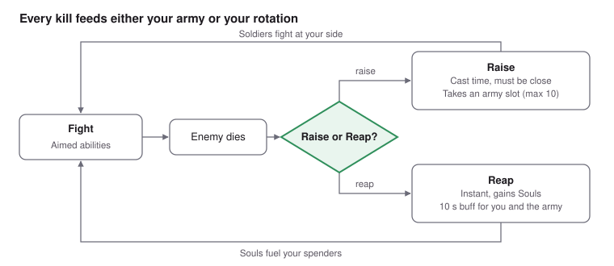

# Dark Touch — Game Design Document

Other versions: [Full reference GDD](GDD-full.md) (every rule in detail) · [Canon](canon.md) (for the AI agents)

Companion documents: [Art direction](art-direction.md) · [Audio and music](audio-and-music.md) · [Lore](lore.md) · [Open questions](open-questions.md)

## 1. Executive Summary

**Dark Touch is a roguelike where a spectral dark-magic arm raises fallen enemies into your army, played with WoW-style GCD and rotation combat using aimed abilities.** A mage who lost an arm made a pact with a dark entity; the cursed arm it gave him casts on its own and turns every kill into a potential soldier. Every corpse is a choice: raise it to grow the army, or reap it to fuel your spells. Hidden stat grades and ranks turn army building into a hunt for the perfect soldier.

| | |
| --- | --- |
| Genre | Roguelike with army building and aimed, rotation-based combat |
| Engine | Unreal Engine 5, Blueprints; C++ only where optimisation requires it |
| Camera | Directly behind and above the player, WoW-style, with zoom in and out |
| Platform | PC, mouse and keyboard; controller may come later, so nothing should block it |
| World and art | Cel'ardor, a continent at war ([Lore](lore.md)); stylised, in the spirit of Fellowship ([Art direction](art-direction.md)) |
| Music | Dark neoclassical, cello-led, adaptive to combat ([Audio and music](audio-and-music.md)) |
| Inspirations | Solo Leveling (raising soldiers), World of Warcraft and Fellowship (ability-bar combat), Diablo 4 (ability variants), Mythic+ (difficulty tiers) |
| Demo scope | One level of 5 sections ending with a boss; 7 spells at the start, 5 more by player level |
| Production | Built over 7 weeks for the ELVTR multi-agent AI course by one designer and a team of 10 AI agents, each gated by the designer's approval. The scope is knowingly ambitious: Dark Touch is the game I have always wanted to make, and I am ready to keep finishing and polishing it for a month or more after the course if needed |

## 2. Game Mechanics

### Core loop

**Fight, kill, then decide what each corpse becomes.** Raising costs time and positioning but grows the army; reaping is instant and fuels your spenders. Across a run, the army you build and the Souls you gather carry you to the boss.

### Combat

**Combat plays like a WoW ability bar, but every ability is aimed by the player.**

- Abilities are instant or have a cast time; a **1-second global cooldown** applies to every spell except Reap. No casting while moving, except Splinters, Grasp, Frenzy, Hunger and Rot.
- Taking a hit does not interrupt a cast: it **pushes the cast back by 1.5 s**. Only stuns interrupt, such as the Mage's charged spell or the Blademaster's parry.
- **No dodge:** enemy windups, like the Blademaster's parry, are answered by stopping the cast and moving away.
- Fillers build Souls; spenders consume them. **Damage is always rounded down to a whole number.**
- **Controls:** rebindable. Defaults A, E, R, F, 1–5 and Shift + the same: 18 slots for the 12 spells, 3 golden-slot abilities and 3 command-group keys.

| Resource | Role | Gained by | Spent on |
| --- | --- | --- | --- |
| Spirit | Army resource, max 100 + 20 per level, no regen | 50 per section, 5 per Reap | Raise 20–180 by rank and grades, revive 60% of the raise cost |
| HP | No regen over time | Hunger; Reap for HP (2 s cast, 20%) | Damage taken |
| Souls | Short loop, Soul Shard-style; max 6 | Deathbolt (1), Splinters (1, 2 with a proc) | Spenders, 3 each |

There is no currency.

| Ability | Role | Aiming |
| --- | --- | --- |
| Deathbolt | 1.75 s cast filler, last priority | Aimed |
| Unholy Impale | Single-target spender, 2 s cast | Aimed |
| Splinters | Instant AoE, 2 charges (5 s each), builds Souls | 30° cone from a narrow base |
| Death Nova | AoE spender, 2 s cast | Ground circle |
| Grasp | Root | Ground circle |
| Swap | Swap places with a soldier | Aimed |
| Frenzy | Timed buff on soldiers | All soldiers |
| Hunger | Instant, 10 s cooldown: eats one of your soldiers (not Chosen), healing you by its HP (capped at 30–60% of your max HP by its rank); it becomes a corpse again | Aimed |
| Rot | Instant hitscan curse, on several enemies: damage every 1 s for 10 s; no Souls | Aimed |
| Power of Below | Offensive cooldown: GCD 0.75 s, casts halved, spenders instant, Splinters 3 s | Self |
| Raise | Turn a corpse into a soldier | Aimed |
| Reap | A 10 s buff, plus 5 Spirit (left click) or 20% HP over a 2 s cast (right click) | Aimed |

Names are final, except Deathbolt and Death Nova. Grasp, Swap, Frenzy, Rot and Power of Below are unlocked by player level. Each ability has **two unlockable variants** (Diablo 4-style); Reap has three: HP regen, damage or speed. Soft-targeting assist vs raw aim is decided during prototyping.

### Rotation

**Fillers build Souls, spenders consume them.** Souls cap at 6; each spender costs 3. Deathbolt gives 1 Soul, Splinters 1 (2 with a proc), Rot none. Base rotation without talismans, single target (in AoE, Death Nova replaces Unholy Impale):

| Priority | Ability | When |
| --- | --- | --- |
| 1 | Unholy Impale / Death Nova | Souls capped: always spend, never overcap |
| 2 | Splinters with a proc | Souls not capped: a proc beats the spender |
| 3 | Unholy Impale / Death Nova | Whenever Souls allow it |
| 4 | Rot | On the main enemy, if it is not cursed (a recast refreshes it to 10 s) |
| 5 | Splinters | Whenever a charge is ready (2 charges, 5 s each) |
| 6 | Deathbolt | 1.75 s cast filler, when nothing else is ready |

- **Splinters proc:** every player hit except Splinters' own has a **10% chance** to give a free Splinters charge and **double its next hit**. Up to 2 procs are held (both charges empowered); a third is lost. Rot's first hit rolls 10%, its later ticks 1%. Soldiers' hits never proc.
- **Free spender proc:** each enemy hit by Splinters has a **5% chance** to make the next spender cost no Souls; only one is stored. AoE taking over the rotation most of the time is intended.
- **Power of Below**, the offensive cooldown: GCD 0.75 s, cast times halved, spenders instant and castable while moving, Splinters charges every 3 s.

### Necromancy and the army

**Every corpse is a choice: Raise it into a soldier, or Reap it for power.**

- **Raise:** costs Spirit by rank (Shadow 50 to General 150), +10 per S grade, −10 per B grade. Cast time, and the player must be close to the corpse, so raising mid-fight is a skill check. Each soldier takes a slot; **10 slots** max at endgame.
- **Reap:** a 10-second buff, plus a choice by mouse: left click for 5 Spirit (instant), right click for 20% of max HP (2 s cast). No Souls.
- **Behaviour:** with no orders, soldiers attack the first enemy they see. Soldiers are dragged into **3 command groups**; a group's key swaps the bar to its orders, **Attack**, **Protect** (hit the biggest threat to the player) and **Move**. **3 golden slots** give their soldier's type ability to the player as a spell.

| Type | Behaviour | Targeting | Player ability |
| --- | --- | --- | --- |
| Guard | Sword-and-shield footman; sometimes shields up, standing and turning slowly | None | **Guard:** damage reduction for 1.5 s |
| Mage | Ranged arcane bolts; occasional long charged spell for massive damage that stuns | Biggest threat to it | TBD |
| Rogue | Dual blades, fast, high damage, squishier; 1 s windup, then dashes through normal mobs | Player and elites first | TBD |
| Tank | Armoured, slow, hits hard, very tough | None | **Taunt:** all nearby enemies focus the Tank, Rogues included |
| Blademaster | Two-handed elite class: sturdy, hard-hitting, fairly fast; occasional parry with a visible windup, sending damage back and stunning | None | **Parry:** sends an attack back at 2x damage |
| Berserker | Leaps onto its target; Whirlwind, a quick AoE around itself | TBD | TBD |

**Elites: a capture system.** Any mob can be an elite: a richer palette, a gold outline on its health bar, and a stat boost. A raised elite is captured, Pokémon-style, and sent to the collection at the base, the menu between runs where the player picks soldiers, talismans and difficulty. Every fallen elite can be captured, with no limit; it keeps its elite status and stats, but is **lost if the player loses the run**. A special capture, possibly a rhythm mini-game, is planned for later.

**Hunting for the right soldier.** Every mob has a random name. Alive, all mobs of a type share the same stats; each mob's **rank** shows on its health bar, and aiming at a corpse opens a widget above it with its rank and hidden **grades** (holding **Alt** shows every health bar and corpse widget):

- **Grades**, one per stat: Vitality (max HP), Attack (damage), Speed (cast speed for ranged, movement speed for melee). S = 1.25x, A = 1x, B = 0.75x.
- **Rank**, inspired by Solo Leveling: Shadow (1), Asset (2), Ace (3), General (4). Rank boosts every stat without changing grades; a better rank almost always means a better soldier, by design. Tiers are endless (20 = top end game); Generals appear from tier 14. Each rank has a colour: shown on enemies' health bars, as a faint aura on corpses, and as a strong aura on soldiers.
- **Effective stat = (Base × Grade) × (1 + (Rank − 1) × 0.5)**: Shadow 1x, Asset 1.5x, Ace 2x, General 2.5x. Higher difficulty tiers give better grade odds.

### Run structure and progression

| Element | Decision |
| --- | --- |
| Levels | Demo: one level ending with a boss. Later: 3 medium levels, each ending with an elite or boss, 20–25 minutes |
| Layout | Outdoors for now, split into 5 sections of about 5 fights, cleared in order with no going back. Leaving a section is a decision point for the army |
| Win / lose | Kill the final boss / player HP reaches 0 |
| Difficulty | Endless Mythic+-style tiers (20 = end game): stronger mobs, more enemies and higher ranks (General from tier 14), better grade odds |

| What | Rule | Win | Death |
| --- | --- | --- | --- |
| Collection | Soldiers raised and won with, plus captured elites | Grows | This run's raises and captures lost |
| Chosen | 0 to 3 soldiers brought from the collection, by player level; the rest is raised in the run | Kept | Kept |
| Talismans | Only gear. Found in hidden chests or dropped by foes; 2 equipped before a run, each boosting one spell; aim: 2–3 new per completed run | To define | To define |
| Player level | Max 15; levels 2–15 unlock 5 spells, 6 variant slots and 3 Chosen slots ([Level Unlocks board](https://claude.ai/artifact/NqX8sL4fDcjPXyauHew4vz)) | Kept | Kept |
| Talents | Passive; some change how Souls are gained | Kept | Kept |

**Fallen soldiers.** Any fallen soldier can be revived for 60% of that soldier's raise cost (12 for a weak Shadow, 108 for an S-grade General). A raised soldier that falls and is not revived before the player leaves the current section is lost for the run; Chosen stay in the collection. Before moving on, the player must choose which fallen soldiers are worth the Spirit. When a run ends, the whole collection is ready again.

## 3. AI Architecture

**Each agent shapes a part of what the player sees, hears and fights; none of them ships anything without the designer's approval.**

| Agent | Its effect on gameplay |
| --- | --- |
| Gameplay Programmer | Every rule in this document becomes a working system the player can feel: aimed casting with the 1.5 s pushback, Raise and Reap, army slots and command groups, grades and ranks, talismans and progression. |
| AI Director | Every enemy and soldier fights with its own readable personality: Rogues dash at the player, Tanks pull aggro with Taunt, Blademasters telegraph their parry. One behaviour per type serves both sides, so a creature you fought plays the same way once raised. |
| Game Feel Director | Every ability, hit, raise and button press has its own feel through hit-stop, camera shake, sound and UI feedback; fillers stay light, spenders hit hard, and raising a soldier is the signature moment. |
| Animation Scraper | Every action and ability has a validated animation on the shared UE5 Manny skeleton, so soldiers and enemies move consistently and the cursed arm stays readable. |
| Environment Scraper | The level is built from coherent, stylised assets that frame each arena and keep characters readable from the camera. |
| UI Designer | The HUD makes the rules visible: the cast bar shows the 1.5 s pushback, the army panel shows names, grades and ranks, and command groups are a drag away. |
| Music Director | The cello-led score shifts between exploration, combat and boss layers, and every raise triggers the same iconic motif. |
| Sound Designer | Every ability and hit gets a distinct sound effect, so the player can read the fight by ear. |
| Technical Director | A full army of 10 soldiers plus enemies keeps a stable frame rate, and systems like casting, raising and slots never conflict. |
| Game Director | Everything above stays consistent with the GDD and with itself: one art style, one audio identity, one set of rules. |

**Review flow:** a builder agent finishes a task → the Technical Director checks that it works → the Game Director checks that it fits the game → the designer validates. Validated facts go into [canon.md](canon.md), which every agent reads first.

## 4. Technical Strategy

### Agent roles

| Agent | Model | What it does | Prompt | Tools and cost |
| --- | --- | --- | --- | --- |
| Gameplay Programmer | Claude Opus 5.5 | Builds the game's systems (abilities, casting, raising, army, grades, progression). For each one, explains how it will build it and waits for your validation; then builds it, you test it, and it iterates until you validate. | [Open prompt](agents/gameplay-programmer.md) | UE5 MCP, or written Blueprint specs. About 20–40k tokens per explanation (roughly $0.15–0.29) and 40–80k per build (roughly $0.29–0.58). |
| Game Director | Claude Opus 5.5 | Called at the end of every meaningful task. Checks the work against the GDD and against existing assets for consistency, then gives a verdict: approved, approved with notes, or changes required. Reviews only; you keep the final word. | [Open prompt](agents/game-director.md) | No external tools. About 10–20k tokens per review, roughly $0.07–0.15 per review. |
| Technical Director | Claude Opus 5.5 | Keeps the map of every system (systems.md). Checks that systems' inputs and outputs fit together, that each piece of data has one owner, and that systems stay loosely coupled. Reviews performance (army AI, Event Tick, arm effects, spawning) and proposes streamlining that keeps the polish. Reviews before the Game Director. | [Open prompt](agents/technical-director.md) | No external tools required; optional Unreal MCP and Unreal Insights captures. About 15–30k tokens per review, roughly $0.11–0.22 per review. |
| Game Feel Director | Claude Sonnet 5.5 | Gives every ability, hit, raise, button press and drag-and-drop its own distinct, polished feel: anticipation, impact, follow-through, camera shake, hit-stop, sound, UI feedback and the arm's effect. Writes a feel spec per interaction and reviews recordings with your 1–5 ratings. | [Open prompt](agents/game-feel-director.md) | No external tools required; reviews GIFs or short videos you record. About 5–10k tokens per spec (roughly $0.02–0.04) and 10–20k per review (roughly $0.04–0.07). |
| UI Designer | TBD | Designs one screen at a time, most important first (in-game HUD, army tab, builds tab, main menu…). Shows 4 mockups per screen, each with a different design intention, then iterates until you validate. Validated screens set the visual language for the next ones. | [Open prompt](agents/ui-designer.md) | HTML mockups at 1920x1080; optional image generation for style frames. About 20–40k tokens per round of 4 mockups; cost TBD with the model. |
| Music Director | Claude Sonnet 5.5 | Creates the music with AI tools: 3 tracks per round, waits for your feedback, iterates until you validate. Also makes the cello raise motif. | [Open prompt](agents/music-director.md) | ElevenLabs Music API, about $0.15 per minute (paid plan from $6/month); Stable Audio about $0.20 per generation; Suno free for exploration. About 5–8k tokens per round, roughly $0.02–0.03; a round of 3 two-minute tracks is about $0.90 in generation. |
| Sound Designer | Claude Haiku 5.5 | Reads the needed-sound list, finds 3 free commercial-safe sounds per entry in public sound banks, and posts them to the Sound Board for you to play, pick, or reject. | [Open prompt](agents/sound-designer.md) | Freesound API (free key), Kenney, OpenGameArt, Pixabay: free. About 4–8k tokens per entry, under $0.01 per entry. |
| AI Director | Claude Opus 5.5 | Owns the behaviour logic of every enemy and soldier, one shared version per type. Builds basic logic first; before each upgrade, presents how it will build it, what it costs and which details it recommends, discusses with you, and implements only once you confirm. | [Open prompt](agents/ai-director.md) | UE5 MCP. About 20–40k tokens per proposal round (roughly $0.15–0.29) and 40–80k per implemented stage (roughly $0.29–0.58). |
| Animation Scraper | Claude Sonnet 5.5 | Finds 2 candidate animations per action and ability, Manny-skeleton first (Fab, Mixamo and others), for you to validate or reject. Then downloads the validated ones, or gives you the link when it needs your account, and retargets them to the UE5 Manny skeleton. | [Open prompt](agents/animation-scraper.md) | UE5 MCP; Mixamo free with an Adobe account, Fab free to paid (you approve purchases). About 5–10k tokens per animation, roughly $0.02–0.04. |
| Environment Scraper | Claude Sonnet 5.5 | Finds 3 stylised candidates per level asset (Fab, Kenney, Quaternius, Sketchfab, Poly Haven) with licence, price and triangle count, and posts them to the Environment Board. Imports the picked ones into a reusable environment library. | [Open prompt](agents/environment-scraper.md) | UE5 MCP; free sources, Fab paid packs only if you approve. About 5–10k tokens per asset, roughly $0.02–0.04. |

**Review boards:** the [Sound Board](https://claude.ai/artifact/RfTmdaNEp5cF3bLusSwN8b) and the [Environment Board](https://claude.ai/artifact/5TxnhfWgdumWg5oXVUhABd) list every needed sound or level asset with 3 candidates: pick one, or ask for 3 more.

### Token budget

**The agents run on a Claude Pro subscription: $20 per month, about $40 for the 7-week course.** Claude Code is included, and its usage shares the same limits as claude.ai: a limit that resets every five hours, plus a weekly limit. Opus agents use those limits faster than Sonnet or Haiku, so the heaviest work is spread across sessions; usage credits can be enabled if a limit blocks a deadline. The per-use costs in the table above are API-equivalent figures, for reference.

| Agent | Model | Assumed workload over 7 weeks | Tokens |
| --- | --- | --- | --- |
| Gameplay Programmer | Opus 5.5 | ~15 systems, each explained, built and fixed twice | ~1.8M |
| Game Director | Opus 5.5 | 60 reviews | ~0.9M |
| Technical Director | Opus 5.5 | 40 reviews | ~0.9M |
| AI Director | Opus 5.5 | 6 proposal rounds, 4 implemented stages | ~0.4M |
| Game Feel Director | Sonnet 5.5 | 15 specs, 20 reviews | ~0.4M |
| UI Designer | TBD | 8 screens × 3 rounds | ~0.7M |
| Animation Scraper | Sonnet 5.5 | 40 animations | ~0.3M |
| Environment Scraper | Sonnet 5.5 | 40 assets | ~0.3M |
| Music Director | Sonnet 5.5 | 10 rounds | ~0.1M |
| Sound Designer | Haiku 5.5 | 30 sounds × 2 rounds | ~0.4M |
| **Total** | | | **~6.3M** |

**Outside the subscription:** about $10 of music generation, plus ElevenLabs from $6 per month. API-equivalent value of the tokens, without the UI Designer: about $33.

### How the agents run (proposed setup, to confirm in week 1)

**Claude Code** (included in Pro) runs each agent as a subagent with its [prompt](agents/) and model; the main session routes each task to an agent, then to the reviewers. Shared memory lives in versioned files (canon.md, systems.md, feel.md, animations.md, reviews.md); every gate is the designer. **Everything is built to be reused** in a future project: generic, data-driven systems with a README each. Details in the [full reference GDD](GDD-full.md).
