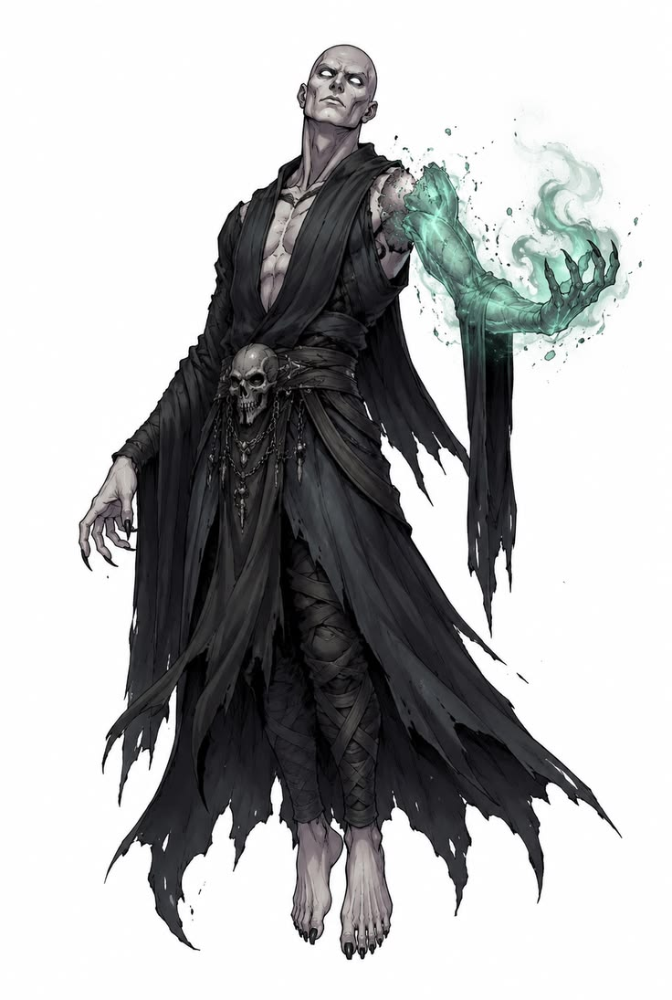

# Dark Touch — Art Direction

Part of the [Dark Touch GDD](GDD.md). Decisions only; open points are in [Open questions](open-questions.md).

## Style

Stylised, in the spirit of **Fellowship**. The world is Cel'ardor, a continent at war (see [Lore](lore.md)).

## Pipeline

1. Concept images created with GPT image generation.
2. 3D characters generated from those images with **Meshy AI**.
3. Characters rigged to the UE5 Mannequin skeleton (see below).

## Skeleton and character setup

- **Every character uses the UE5 Mannequin skeleton**, so animations are shared without retargeting.
- **The player is made of two skeletal meshes** on that same skeleton: the body without the right arm, and the cursed arm alone. The arm gets its own material and effects without touching the body.

### The main character

Validated concept (front and back), the reference for the 3D model:

- **Hood** with two small golden horns; **ornate golden mask** with glowing cyan eyes, the face lost in shadow.
- **Tattered olive-green mantle** over the shoulders, longer at the back, down to the waist.
- **Dark brown leather armour** with thin gold trims; **golden chains** across the chest and kept short and tight at the belt.
- **No long coat:** the outfit stops at the belt. Below it, only fitted leather trousers with buckled straps and wrapped leather boots, so the legs need no cloth animation.
- **Athletic build**, close to the UE5 Manny proportions, so the rig and shared animations fit with little clipping.
- **Left arm:** normal, in a dark leather glove. **Right arm:** the dark-magic arm, in **cyan-turquoise**, matching the eyes.
- Only the mantle may need light physics (one Kawaii Physics or AnimDynamics chain on its back strips).

## The weapon: the dark-magic arm

The player fights without a blade. The right arm is not physical: it is pure dark magic, translucent and glowing **cyan-turquoise**, made of swirling spectral energy that drifts off as wisps and particles, with long clawed fingers. Although it is not flesh, it acts like a real arm: it can **strike, grab and hold things**, which is how it casts, raises and reaps.

*Early reference for the arm's shape and effects; its colour is now cyan-turquoise, as in the main character concept.*

It is the game's visual signature and **must stand out in every animation**: casting, raising, reaping and idle all need a distinctive effect on the arm.

## Environment assets

Level assets (rocks, trees, ruins, war camp and village props, chests, ground, sky) are stylised and slightly desaturated so characters and the cyan arm pop. They are found by the [Environment Scraper](agents/environment-scraper.md) and reviewed on the [Environment Board](https://claude.ai/artifact/5TxnhfWgdumWg5oXVUhABd).

## Readability palettes

**Enemies are warm and alive; summons are cold and spectral.** Warm against cool reads fastest, and orange against cyan stays clear for colour-blind players. Each type uses one mesh with one material: a "Raised" parameter switches it from the enemy palette to the summon palette and lights up the cyan glow.

| Enemies (living) | Hex | Summons (raised) | Hex |
| --- | --- | --- | --- |
| Tabards and cloth: burnt orange | `#C8641E` | Body and armour: slate grey | `#5E6670` |
| Secondary cloth: ivory | `#E8DCC0` | Cloth: ashen blue-grey | `#3E4650` |
| Armour: warm steel | `#9A9590` | Skin: corpse pale | `#A9B0B0` |
| Leather: tan | `#8A5A34` | Eyes, veins, cracks (emissive): the arm's cyan | `#3FE0D0` |
| Skin: warm flesh | `#C99A7A` | | |

- Summons share the player's cyan, so they read as his. The main character (dark brown, olive, gold) reads as neither.
- Elites keep the enemy palette, richer: darker, more saturated orange, heavier dark-bronze armour, bigger trims.
- Check: an enemy and a summon side by side must stay distinct in black and white.

## Rank colours

Each rank has a colour:

| Rank | Colour |
| --- | --- |
| Shadow | Pale green |
| Asset | Purple |
| Ace | Black, with a thin silver edge so it reads on dark shapes |
| General | Deep red with a black outline, kept distinct from the enemies' orange |

- **On enemies:** no effect on the body. The rank shows on the **health bar**, styled like the default modern WoW (retail) nameplate health bar, with no add-ons. **Elites** get a **gold outline** on their health bar.
- **On corpses:** a **faint aura**, weaker than on summons but still visible, so the player can scan the battlefield for good ranks. Aiming at a corpse opens a world widget above it with its name, rank and stat grades (gold outline for elites); holding **Alt** shows every health bar and corpse widget at once.
- **On summons:** the rank is an **aura**, an overlay on the skeletal mesh material plus a little smoke. It **dominates the summon palette** and is more visible than the base material.

## Elites

Any mob can be an elite: it has an aura, a slightly different colour palette, and a stat boost over the normal version. A raised elite is captured and sent to the army at the base.
